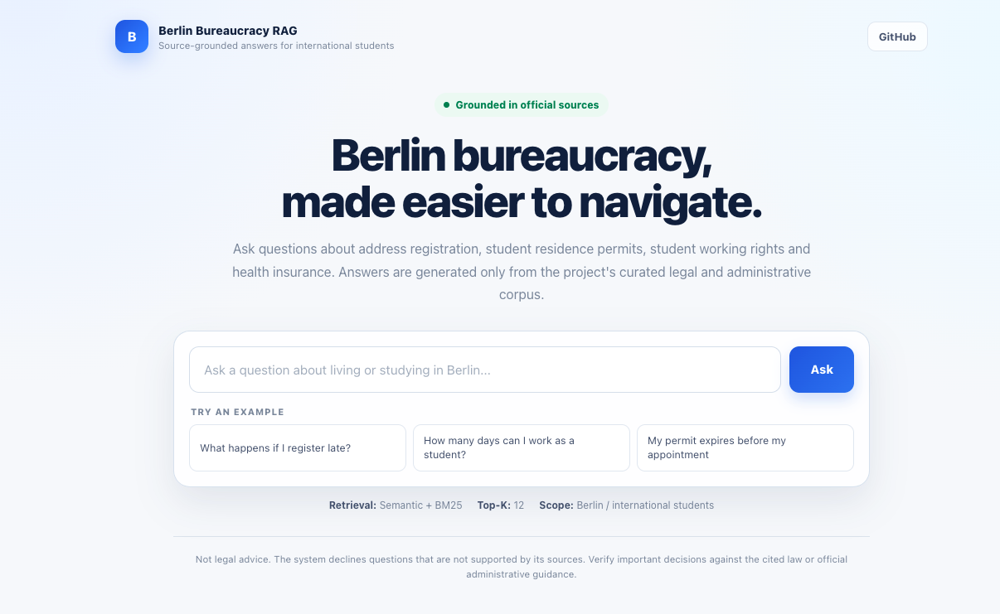

# Berlin Bureaucracy RAG

A retrieval-augmented question-answering system for international students in Berlin.
It answers questions on registration, residence permits, working rights, and health
insurance from German statutes and official Berlin sources, cites its sources, and
declines when they do not support an answer.

**[Live demo](https://berlin-bureaucracy-rag-1.onrender.com)** · Not legal advice.



## Results

Evaluated on 100 realistic student questions, each answer checked manually against its cited source.

| Correct | Correctly declined | Wrong | Partial | Stale source |
|:---:|:---:|:---:|:---:|:---:|
| 76 | 20 | 2 | 1 | 1 |

Out-of-scope questions are included on purpose to measure refusal behaviour.
With 100 questions, the margin of error is roughly ±9 points.

## How it works

```text
question → semantic search + BM25 (with German legal query rewrite)
         → weighted fusion (70 / 30) → top 12 chunks
         → GPT-5.6 generation with citations, or refusal
```

## Limitations

- Answers can differ between English and German phrasings of the same question.
- Annual amounts and thresholds require regular corpus updates.

## Quick start

```bash
git clone https://github.com/HassanHijaze/berlin-bureaucracy-rag.git
cd berlin-bureaucracy-rag
pip install -r requirements.txt
echo OPENAI_API_KEY=your_key > API.env
uvicorn api:app --port 8000
```

Run tests with `pytest` (offline) or `pytest -m live` (calls the API).

## Tech stack

Python · FastAPI · OpenAI · BM25 · pytest · Docker · Render