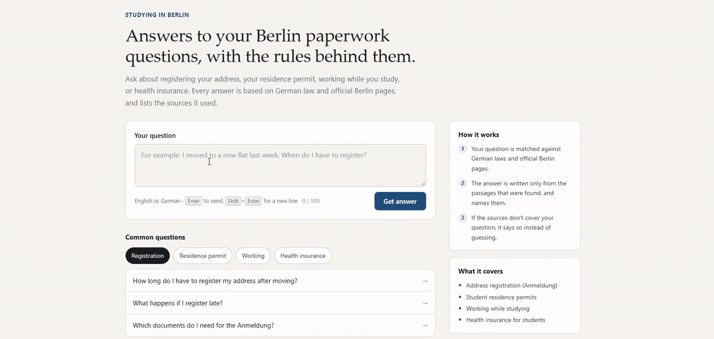
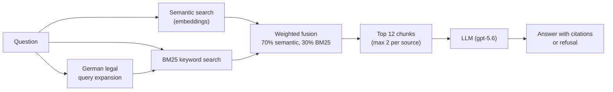

# Berlin Bureaucracy RAG

Question answering for international students in Berlin: address registration, residence permits,
working while studying and health insurance. Answers come only from German statutes and official
Berlin sources, cite the sources they used, and decline when the sources don't cover the question.

[](https://www.python.org/)
[](https://fastapi.tiangolo.com/)
[](Dockerfile)
[](https://platform.openai.com/)
[](LICENSE)



**Live demo:** [berlin-bureaucracy-rag-1.onrender.com](https://berlin-bureaucracy-rag-1.onrender.com/) · Not legal advice.


## Key features

- **Hybrid retrieval:** BM25 keyword search and OpenAI embeddings, fused 70% semantic / 30% BM25.
- **German legal query expansion:** English questions are rewritten into German legal terms, so they still find German statutes.
- **Cited answers:** every answer lists the laws and official pages it is based on.
- **Honest refusal:** when the sources don't cover a question, it says so instead of guessing.

## Results

100 realistic student questions, each answer checked manually against its cited source:

| Correct | Correctly declined | Wrong | Partial | Stale source |
|:---:|:---:|:---:|:---:|:---:|
| 76 | 20 | 2 | 1 | 1 |

The set deliberately includes out-of-scope questions to test whether the system declines correctly.

## How it works



The corpus of 68 documents (statute sections and official pages) is split into 614 chunks: statutes
at their paragraph markers, Berlin pages at their section headings. Each question is searched two
ways, by meaning (embeddings) and by keywords (BM25 on the question plus its German expansion), and
the normalised scores are combined. The 12 best chunks, at most 2 per source, go to the model, which
must answer only from them and cite each source, or reply that the sources do not cover the question.

## Project structure

```text
berlin_rag/       settings, CLI, evaluation harness, citation helpers, OpenAI client
├── api/          FastAPI app: routes, request/response schemas, daily rate limit
├── corpus/       load documents and split them into chunks
├── retrieval/    BM25, embeddings and vector cache, query expansion, hybrid search
├── generation/   answer prompt, refusal detection, answer generation
└── static/       web interface (single HTML page)
tests/
├── unit/         offline tests, no API key needed
└── integration/  tests against the real OpenAI API (marked live)
```

## Quick start

**Prerequisites:** Python 3.12, an OpenAI API key, Docker (optional).

```bash
git clone https://github.com/HassanHijaze/berlin-bureaucracy-rag.git
cd berlin-bureaucracy-rag
python -m venv .venv
source .venv/bin/activate          # macOS/Linux
.venv\Scripts\activate             # Windows (cmd)
source .venv/Scripts/activate      # Windows (Git Bash)
pip install -r requirements.txt
```

Copy the example file and add your OpenAI API key:

```bash
cp .env.example API.env            # Windows: copy .env.example API.env
```

**Web app and API** at http://127.0.0.1:8000 (interactive API docs at `/docs`):

```bash
uvicorn berlin_rag.api.main:app --port 8000
```

**Docker:**

```bash
docker build -t berlin-bureaucracy-rag .
docker run --rm --env-file API.env -p 8000:8000 berlin-bureaucracy-rag
```

**Command line:**

```bash
python -m berlin_rag.cli ask "How long do I have to register my address?"
python -m berlin_rag.cli evaluate                       # all 100 questions
python -m berlin_rag.cli evaluate --sample 10           # 10 random questions
python -m berlin_rag.cli evaluate --sample 10 --seed 42 # the same 10 again
```

## Testing & quality

```bash
pip install -r requirements-dev.txt

pytest            # offline unit tests, no API key needed
pytest -m live    # integration tests against the OpenAI API (costs money)
black .           # format
ruff check .      # lint, including type hints and docstrings
```

`tests/unit/test_search_ranking.py` pins the exact top-12 ranking for fixed questions, so a
refactor cannot silently change which sources the model sees.

## Updating the corpus

If you change the corpus, run any question once with an API key to rebuild the embedding cache
in `data/cache/`, and commit the new `.npy` file.

## Limitations

- The corpus is limited and does not cover every administrative question about living in Germany. Topics outside it are intentionally refused.
- Answers reflect the sources as of when they were downloaded, so dated figures such as the blocked-account amount can go out of date; annual amounts and thresholds need regular corpus updates.
- Retrieval can miss a relevant section that is in the corpus, for example § 8 SGB V for the question on private health insurance.
- Answers can differ between English and German phrasings of the same question.

## Data & licence

Code: [MIT](LICENSE).

The documents in `data/corpus/` are reproduced from public German government, Berlin state, and
insurer sources for evaluation purposes and remain the property of their publishers.

Not legal advice. Check important decisions against the cited law or the responsible office.

## Author

Hassan Hijazi · [GitHub](https://github.com/HassanHijaze) · [LinkedIn](https://www.linkedin.com/in/hassanhijazi-ai)
